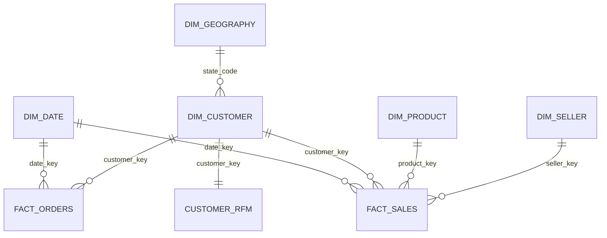
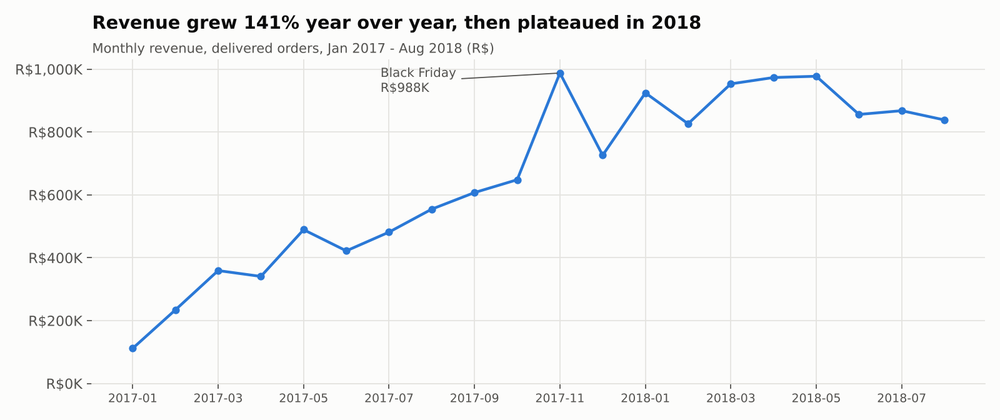
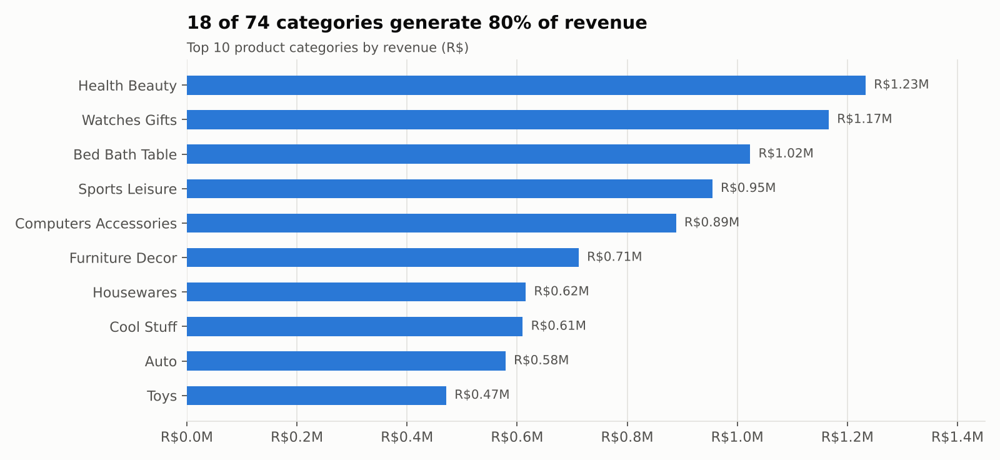
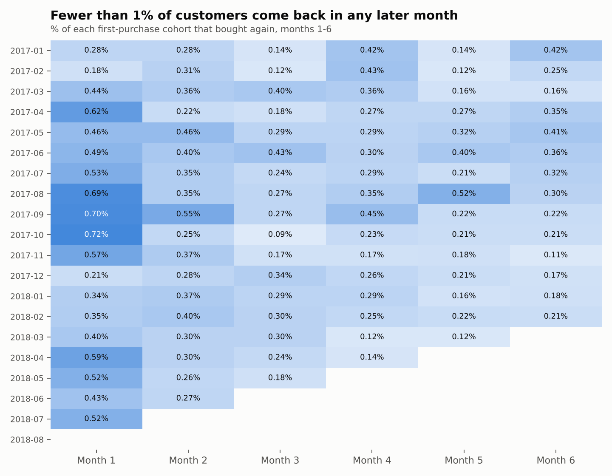
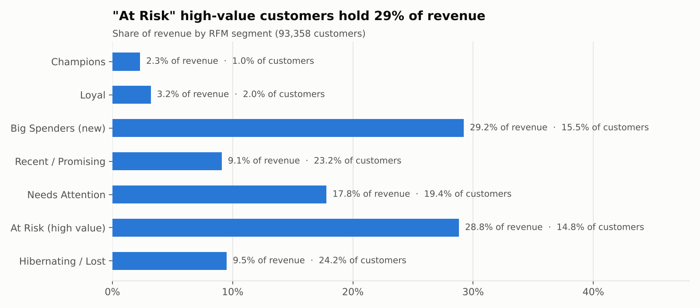
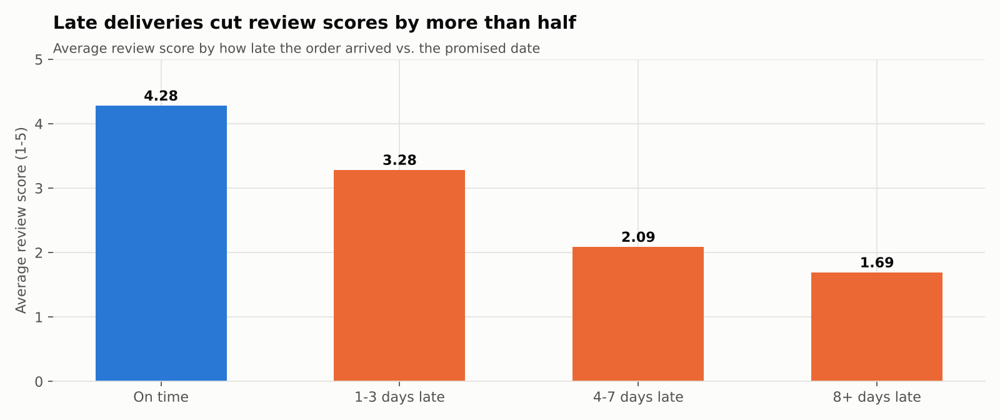

# RetailPulse — Retail Sales & Customer Insights Analytics

**End-to-end business intelligence on 100K+ real e-commerce orders.**
SQL (PostgreSQL) · Dimensional Modeling · Power Query (M) · DAX · Power BI

RetailPulse turns nine raw tables from **Olist**, a Brazilian online marketplace (2016-2018), into a clean star schema and an analysis that answers one question for leadership: *where does revenue come from, why don't customers come back, and what is hurting satisfaction?*

---

## Key findings at a glance

| | |
|---|---|
| **R$13.2M** revenue from **96,478** delivered orders | Average order value **R$137** |
| Revenue **+141% YoY** (Jan-Aug 2018 vs 2017) | ...but flat at ~R$0.85-0.98M/month through 2018 |
| Only **3.0%** of customers ever order again | Fewer than **0.5%** return in the following month |
| Orders **8+ days late** average **1.69 stars** | vs. **4.28** for on-time orders |
| Late orders are **6.8%** of deliveries | ...but cause **32%** of all 1-2 star reviews |

All figures are produced by the SQL in this repo and can be reproduced in under a minute.

---

## Business questions

| # | Question | Where it's answered |
|---|---|---|
| Q1 | How are revenue, orders and AOV trending? | `06_analysis_sales.sql` §6.2-6.3 |
| Q2 | Which categories and sellers drive revenue? | `06_analysis_sales.sql` §6.4-6.5 |
| Q3 | Which regions buy most, and what does freight cost them? | `06_analysis_sales.sql` §6.6 |
| Q4 | Do customers come back? | `07_analysis_customers.sql` §7.1, §7.3 |
| Q5 | Who are the most valuable customers, and who is at risk? | `07_analysis_customers.sql` §7.2 |
| Q6 | Do late deliveries hurt satisfaction? Where? | `08_analysis_delivery.sql` |
| Q7 | How do customers pay? | `06_analysis_sales.sql` §6.7 |
| Q8 | What should the business do next? | [Recommendations](#recommendations) |

---

## Architecture

```
Raw CSVs (9 files)
   -> PostgreSQL staging      sql/01-02   typed tables, loaded as-is
   -> Data-quality checks     sql/03      18 checks, documented
   -> Star schema             sql/04-05   2 facts + 5 dimensions, reconciled to source
   -> Analysis                sql/06-08   CTEs + window functions
   -> Export                  sql/09      data/processed/*.csv
   -> Power Query (M)         powerquery/ types, labels, date table
   -> DAX semantic layer      dax/        45+ measures, what-if margin
   -> Power BI dashboard      powerbi/    5 pages
```

Heavy logic (deduplication, aggregation, joins) lives in **SQL**, where it is testable and tool-independent. Presentation-level shaping lives in **Power Query**. Business logic for KPIs lives in **DAX**.

## Data model



**Two fact tables at different grains, by design:**
- `fact_sales` — one row per **order item** (110,197 rows): revenue, freight, product and seller analysis.
- `fact_orders` — one row per **order** (99,441 rows): delivery time, lateness, review score, payments, cancellations.

Putting delivery days or review scores on item rows would repeat them for multi-item orders and inflate averages.

Full column definitions: [`docs/data_dictionary.md`](docs/data_dictionary.md)

---

## Data quality

18 checks run before modeling ([`docs/data_quality_report.md`](docs/data_quality_report.md)). The ones that change the analysis:

- **`customer_id` is not the customer.** Olist issues a new `customer_id` on every order. The real person is `customer_unique_id`. Counting `customer_id` would make *every* customer look like a one-time buyer. All customer metrics use `customer_unique_id`.
- **555 orders have multiple reviews**, so only the latest review per order is kept (`ROW_NUMBER()`).
- **Payments are not 1:1 with orders** (vouchers, split payments, installment interest), so revenue is measured from item price and payments are aggregated to order level before joining.
- **Edge months are nearly empty** (Sep-Dec 2016, Sep-Oct 2018), so trends use complete months only.
- **No product cost exists in the data.** Profitability is shown as an **estimated margin** driven by an adjustable what-if parameter, not invented numbers.

The modeled tables reconcile to the source exactly: R$13,221,498.11 delivered revenue and 99,441 orders in both.

---

## Findings

### 1. Strong growth that stalled


Revenue grew **141%** year over year (Jan-Aug), with order volume up **140%**. Growth came from more orders, not bigger baskets: AOV stayed around R$125-150. Black Friday (Nov 2017) was the peak month at R$988K. Since January 2018, monthly revenue has been **flat to slightly down**.

### 2. Revenue is concentrated


- **18 of 74 categories** produce 80% of revenue. Health & Beauty and Watches & Gifts lead.
- The **top 10% of sellers** (297 of 2,970) generate **67%** of revenue.
- The **Southeast** region generates **65%** of revenue. The North and Northeast pay the most freight relative to order value (**22-23%** vs. 15% in the Southeast) but also have the **highest AOV** (R$166-182).
- Credit card covers **75%** of orders, at an average of **3.5 installments**.

### 3. Customers almost never come back


- Only **3.0%** of customers placed a second delivered order. They contributed just 5.5% of revenue.
- Repeat customers spend **R$260** on average vs. **R$138** for one-time buyers.
- Across cohorts, **0.48%** buy again in the month after their first purchase, falling to ~0.23% by month 6.
- Among those who do return, the median gap is **29 days**, and **68%** return within 90 days. **The first 90 days are the only real retention window.**

### 4. Value at risk


RFM segmentation of 93,358 customers:
- **At Risk (high value):** 14.8% of customers who hold **28.8% of revenue**. They spent R$277 on average but last bought ~13 months ago.
- **Big Spenders (new):** 15.5% of customers and 29.2% of revenue, recent and high-value. This is the group to convert into repeat buyers *now*.

### 5. Late delivery is the biggest driver of bad reviews


| Delivery | Share of orders | Avg review | 1-2 star reviews |
|---|---:|---:|---:|
| On time | 93.2% | 4.28 | 9.5% |
| 1-3 days late | 1.9% | 3.28 | 32.4% |
| 4-7 days late | 1.9% | 2.09 | 68.1% |
| 8+ days late | 3.0% | **1.69** | **79.5%** |

- Late orders are **6.8%** of deliveries but cause **32%** of all 1-2 star reviews.
- The **Northeast** has about twice the late rate of the Southeast and South (**12.7%** vs. ~6%, with 20-day average delivery). Worst states: **Maranhão** (17.4% late), **Ceará** (13.8%), **Bahia** (12.2%), and **Rio de Janeiro** (12.1%), the second-largest market.
- On-time performance broke down after Black Friday and in **Feb-Mar 2018 (81-86% on time)**, and review scores fell with it (3.80 in March).

---

## Recommendations

| # | Recommendation | Evidence | KPI to track |
|---|---|---|---|
| 1 | **Launch a 30-90 day post-purchase program** (thank-you voucher, cross-sell from the same category) for first-time buyers. Prioritize the *Big Spenders (new)* segment. | Repeat rate 3%; 68% of repeats happen within 90 days; repeat buyers spend 1.9x more | Repeat Customer %, month-1 to 3 cohort retention |
| 2 | **Win-back campaign for *At Risk (high value)* customers.** | 14.8% of customers, 28.8% of revenue, ~13 months inactive | Reactivated customers, revenue from segment |
| 3 | **Fix the Northeast and Rio de Janeiro logistics first**: add carrier capacity or local sellers. Until then, **pad the promised delivery date** there, since lateness is measured against the promise. | 2x late rate; late orders drive 32% of bad reviews | On-Time Rate %, Bad Review % by state |
| 4 | **Peak-season readiness** — scale carrier capacity before Black Friday and Q1. | On-time fell to 81-88% in Nov 2017 and Feb-Mar 2018 | Monthly On-Time Rate % |
| 5 | **Protect the core** — seller-quality and stock programs for the top 18 categories and top 10% of sellers. Recruit sellers in the North and Northeast to cut freight. | 80% of revenue from 18 categories; 67% from top 10% of sellers; 22% freight burden in N/NE | Category revenue share, Freight % of Revenue |

---

## Repository structure

```
RetailPulse/
├── README.md
├── data/
│   ├── raw/                  # original Olist CSVs (8 files)
│   └── processed/            # star schema exported by sql/09
├── sql/
│   ├── run_all.sql           # runs everything in order
│   ├── 01_create_staging.sql
│   ├── 02_load_data.sql
│   ├── 03_data_quality_checks.sql
│   ├── 04_build_dimensions.sql
│   ├── 05_build_facts.sql
│   ├── 06_analysis_sales.sql
│   ├── 07_analysis_customers.sql
│   ├── 08_analysis_delivery.sql
│   └── 09_export_processed.sql
├── powerquery/               # M scripts for every table + date table
├── dax/measures.dax          # all measures, commented, by display folder
├── powerbi/                  # RetailPulse.pbix
└── docs/
    ├── data_dictionary.md
    ├── data_quality_report.md
    ├── dashboard_build_guide.md
    └── images/
```

## SQL techniques used

| Technique | Where |
|---|---|
| CTEs (multi-step) | every script from 04 onward |
| `LAG` — month-over-month growth | 06 §6.2 |
| `AVG() OVER (ROWS BETWEEN 2 PRECEDING ...)` — moving average | 06 §6.2 |
| `SUM() OVER (ORDER BY ...)` — running total, Pareto cumulative share | 06 §6.2, §6.4 |
| `DENSE_RANK`, `RANK` | 06 §6.4, 08 §8.4 |
| `NTILE` — seller deciles, RFM scores | 06 §6.5, 07 §7.2 |
| `ROW_NUMBER` — dedupe reviews, latest address, main payment type | 04, 05 |
| `LEAD` — days to second purchase | 07 §7.1 |
| `FIRST_VALUE` — cohort size | 07 §7.3 |
| `FILTER (WHERE ...)`, `PERCENTILE_CONT` | 06, 07, 08 |
| Reconciliation checks | 03, 05 |

## How to run it

**Requirements:** PostgreSQL 14+ (on Mac: [Postgres.app](https://postgresapp.com)), and Power BI Desktop for the dashboard.

```bash
git clone https://github.com/likhi1018/RetailPulse.git
cd RetailPulse
createdb retailpulse
psql -d retailpulse -f sql/run_all.sql
```

Then build the dashboard with [`docs/dashboard_build_guide.md`](docs/dashboard_build_guide.md).

## Dashboard

Five pages: **Executive Overview · Sales & Products · Customers · Delivery & Satisfaction · Insights & Actions**.
Screenshots: *coming soon* (`docs/images/dashboard_*.png`).

> The charts above were generated directly from the SQL results to illustrate the findings. The interactive version lives in the Power BI report.

## Data source & license

[Brazilian E-Commerce Public Dataset by Olist](https://www.kaggle.com/datasets/olistbr/brazilian-ecommerce) (Kaggle), released under **CC BY-NC-SA 4.0**. Real, anonymized commercial data. Amounts are in Brazilian reais (R$). The geolocation file is not included; maps use state-level data.
Code in this repository is MIT-licensed.
