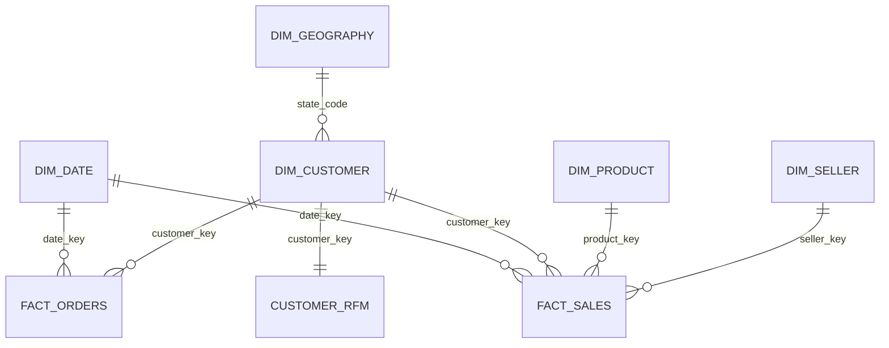

# Data Dictionary

All modeled tables live in the `analytics` schema and are exported to `data/processed/`.
Money is in **Brazilian reais (R$)**.

## Star schema

---

## fact_sales
**Grain:** one row per order item, **delivered orders only** (110,197 rows).

| Column | Type | Description |
|---|---|---|
| order_id | text | Order identifier (part of the key) |
| order_item_id | int | Item sequence within the order (part of the key) |
| date_key | int | Purchase date as YYYYMMDD -> dim_date |
| customer_key | int | -> dim_customer |
| product_key | int | -> dim_product |
| seller_key | int | -> dim_seller |
| price | numeric | Item price paid by the customer (revenue) |
| freight_value | numeric | Shipping charged for this item |
| gross_item_value | numeric | price + freight_value |

## fact_orders
**Grain:** one row per order, **all statuses** (99,441 rows).

| Column | Type | Description |
|---|---|---|
| order_id | text | Primary key |
| date_key | int | Purchase date -> dim_date |
| customer_key | int | -> dim_customer |
| state_code | char(2) | State on this order's delivery address |
| order_status | text | delivered, shipped, canceled, unavailable, invoiced, processing, created, approved |
| is_delivered | int | 1 if delivered |
| is_canceled | int | 1 if canceled or unavailable |
| items_count | int | Number of items in the order |
| items_value | numeric | Sum of item prices |
| freight_value | numeric | Sum of freight |
| payment_total | numeric | Sum of all payments on the order |
| payment_count | int | Number of payment records |
| max_installments | int | Largest number of installments used |
| main_payment_type | text | Payment type that covered the largest amount |
| delivery_days | numeric | Days from purchase to customer delivery (blank if not delivered) |
| delay_days | int | Delivery date minus promised date; > 0 means late |
| is_late | int | 1 if delivered after the promised date (blank if not delivered) |
| delay_bucket | text | 1. On time / 2. 1-3 days late / 3. 4-7 days late / 4. 8+ days late |
| review_score | int | 1-5, latest review on the order |

## dim_customer
**Grain:** one row per real customer (`customer_unique_id`), 96,096 rows.

| Column | Type | Description |
|---|---|---|
| customer_key | int | Surrogate key |
| customer_unique_id | text | The real person (source id) |
| city, state_code, region | text | From the customer's most recent order |
| first_order_date / last_order_date | date | First and last delivered purchase |
| cohort_month | date | Month of first delivered purchase |
| delivered_orders | int | Number of delivered orders |
| customer_type | text | One-time / Repeat / No delivered order |

## dim_product
**Grain:** one row per product, 32,951 rows.

| Column | Type | Description |
|---|---|---|
| product_key | int | Surrogate key |
| product_id | text | Source id |
| category_pt | text | Original Portuguese category |
| category | text | English category, title case ("Unknown" if missing) |
| product_weight_g | int | Weight in grams |
| weight_class | text | Light / Medium / Heavy / Very heavy |
| product_photos_qty | int | Number of listing photos |

## dim_seller
**Grain:** one row per seller, 3,095 rows. Columns: `seller_key`, `seller_id`, `city`, `state_code`, `region`.

## dim_geography
**Grain:** one row per Brazilian state, 27 rows. Columns: `state_code`, `state_name`, `region` (North, Northeast, Central-West, Southeast, South).

## dim_date
**Grain:** one row per day, 1 Sep 2016 - 31 Oct 2018 (791 rows).
Columns: `date_key`, `date`, `year`, `quarter_num`, `quarter`, `month_num`, `month_name`, `year_month`, `month_start`, `weekday_num`, `weekday_name`, `is_weekend`.

## customer_rfm
**Grain:** one row per customer with at least one delivered order (93,358 rows).

| Column | Description |
|---|---|
| recency_days | Days between last purchase and the day after the last order in the data |
| frequency | Number of delivered orders |
| monetary | Total item spend |
| r_score, m_score | 1-5 quintiles (`NTILE(5)`); 5 = most recent / highest spend |
| f_score | Rule-based: 1 order = 1, 2 orders = 3, 3+ orders = 5 (NTILE would split identical values) |
| rfm_code | e.g. "515" |
| segment | Champions, Loyal, Big Spenders (new), Recent / Promising, Needs Attention, At Risk (high value), Hibernating / Lost |

## cohort_retention
**Grain:** one row per first-purchase cohort month x months since first purchase (complete months only).
Columns: `cohort_month`, `month_index` (0 = first month), `active_customers`, `cohort_size`, `retention_pct`.
